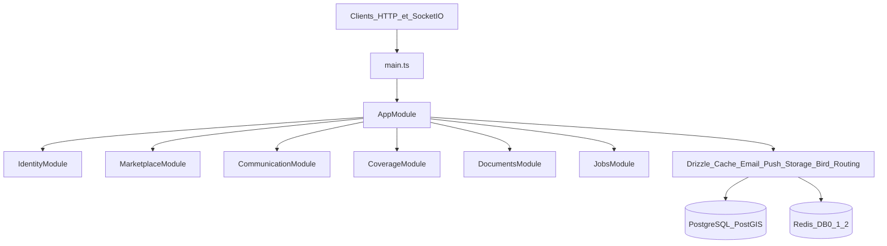
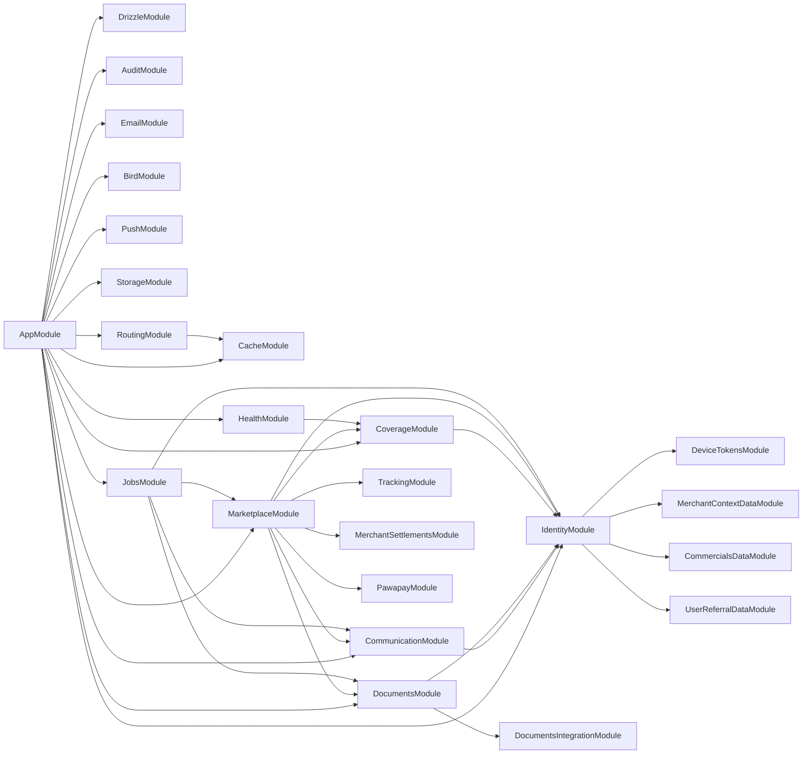
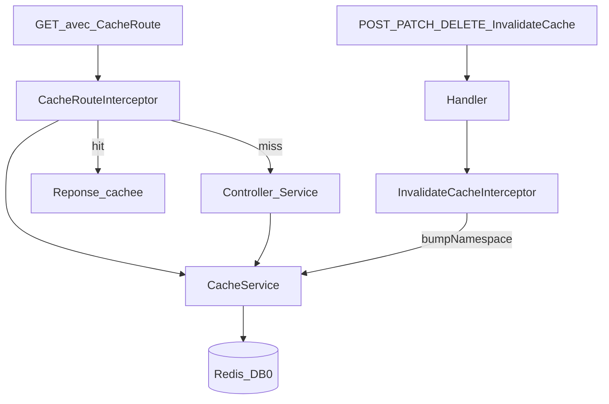
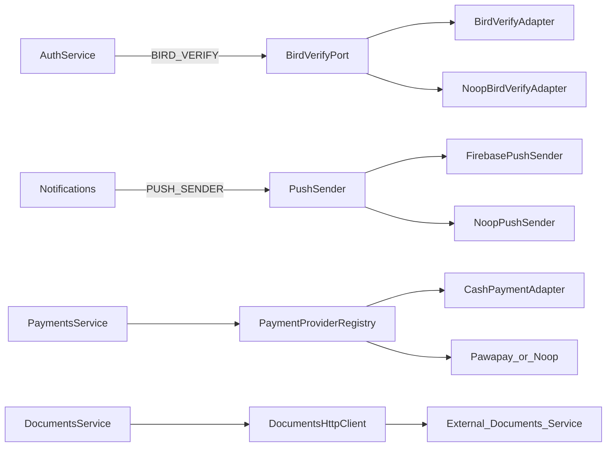
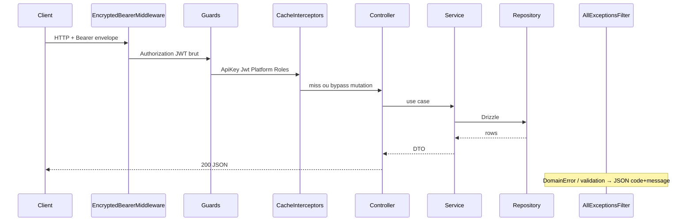
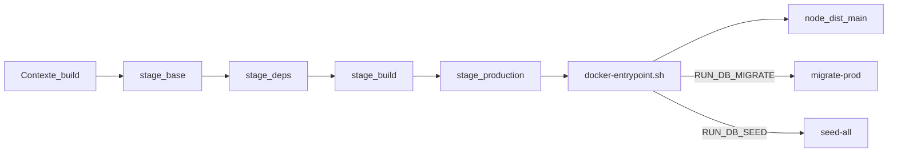
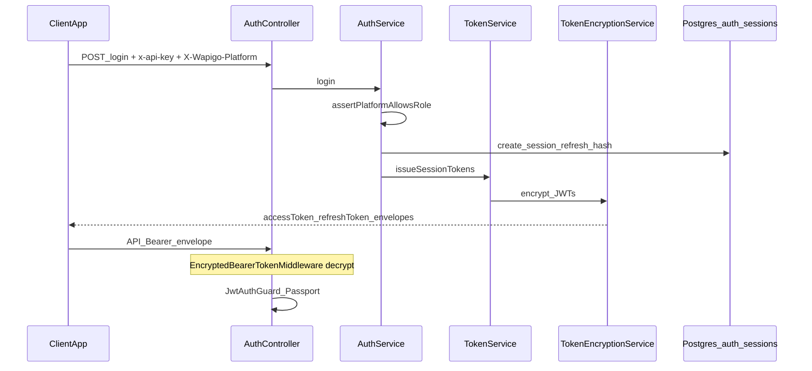
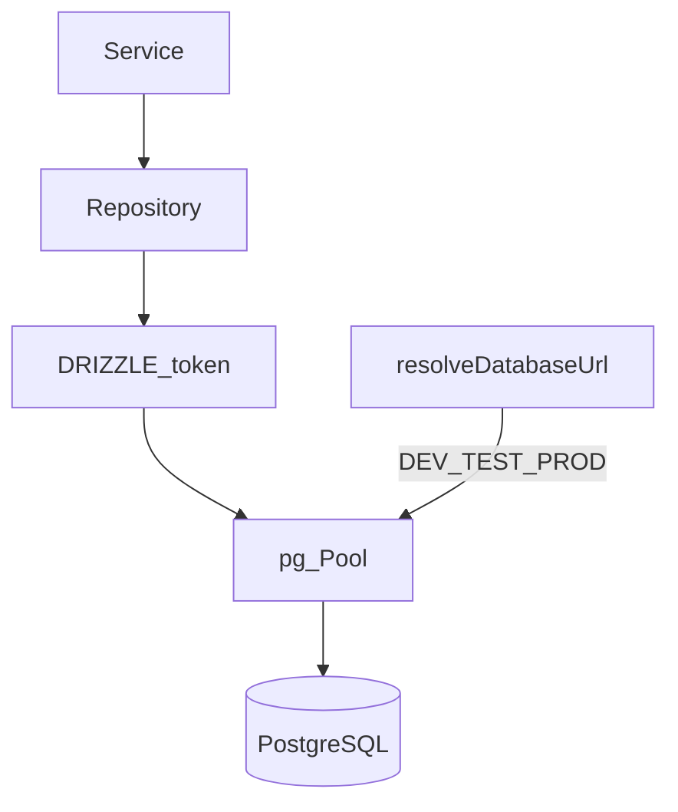
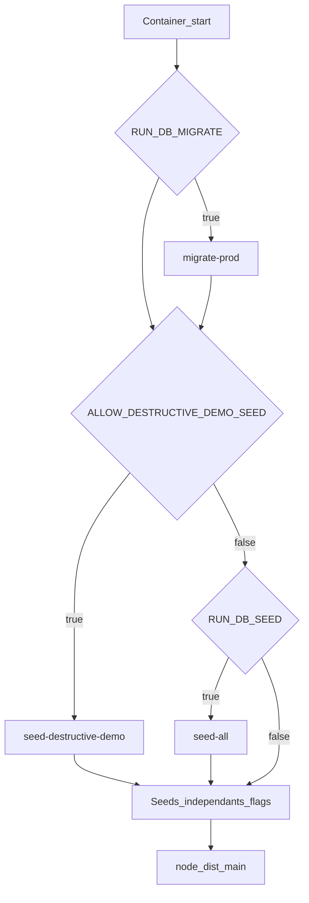
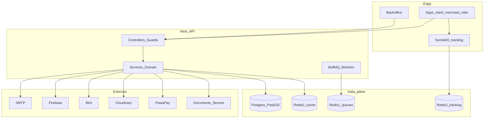

# Documentation technique de référence — Backend Wapigo

> **Objectif.** Document d’ingénierie logicielle exhaustif du backend NestJS **Wapigo** (`backend.wapigodrc.com`). Il décrit l’architecture, les fondations techniques et les conventions **réellement présentes dans ce dépôt**, pour permettre au développeur du **boilerplate NestJS distinct** de moderniser / upgrader ce starter à partir d’un usage de production.
>
> Ce n’est **pas** un README commercial. Le démarrage local opérationnel reste dans [`docs/getting-started.md`](docs/getting-started.md).

| Métadonnée | Valeur observée |
|---|---|
| Produit | **Wapigo** (`APP_NAME=Wapigo API` dans `.env.example`) |
| Package npm | `nestjs-boilerplate` (nom historique du boilerplate, non renommé) |
| Auteur package | Norbert Yemuang |
| Runtime | Node.js `>=24`, pnpm `>=10.1.0` |
| Framework | NestJS 11 |
| Style | Monolithe modulaire |
| Licence | MIT |

**Périmètre de ce document**

- Analyse basée uniquement sur le code et les configs de **ce** repository.
- Aucune affirmation inventée ; les éléments partiels ou placeholders sont signalés.
- **Aucun secret** : seuls les *noms* de variables d’environnement sont listés.
- Le repository GitHub du boilerplate n’est pas analysé ici.

---

## Table des matières

1. [Stack et prérequis](#1-stack-et-prérequis)
2. [Arborescence et architecture globale](#2-arborescence-et-architecture-globale)
3. [Bootstrap NestJS et couches applicatives](#3-bootstrap-nestjs-et-couches-applicatives)
4. [Catalogue des modules NestJS](#4-catalogue-des-modules-nestjs)
5. [Base de données et ORM (Drizzle / PostgreSQL / PostGIS)](#5-base-de-données-et-orm-drizzle--postgresql--postgis)
6. [Cache et Redis](#6-cache-et-redis)
7. [Adaptateurs, providers et intégrations](#7-adaptateurs-providers-et-intégrations)
8. [Authentification et sécurité](#8-authentification-et-sécurité)
9. [Validation, erreurs et requêtes HTTP](#9-validation-erreurs-et-requêtes-http)
10. [Logging, monitoring et observabilité](#10-logging-monitoring-et-observabilité)
11. [Swagger et Postman](#11-swagger-et-postman)
12. [Docker, conteneurisation et déploiement](#12-docker-conteneurisation-et-déploiement)
13. [Configuration et variables d’environnement](#13-configuration-et-variables-denvironnement)
14. [Tests et qualité du code](#14-tests-et-qualité-du-code)
15. [Agents IA, règles et conventions](#15-agents-ia-règles-et-conventions)
16. [Scripts et commandes](#16-scripts-et-commandes)
17. [Diagrammes techniques](#17-diagrammes-techniques)
18. [Informations destinées au développeur du boilerplate](#18-informations-destinées-au-développeur-du-boilerplate)

---

## 1. Stack et prérequis

### Stack runtime

| Couche | Technologie | Ancrage |
|---|---|---|
| API | NestJS 11 (`@nestjs/common` ^11) | `package.json` |
| Langage | TypeScript ~5.7 | `tsconfig*.json` |
| HTTP | Express (`@nestjs/platform-express`) | |
| Temps réel | Socket.IO + `@socket.io/redis-adapter` | tracking livraison |
| ORM | Drizzle ORM ^0.45 + `pg` | `src/database/` |
| DB | PostgreSQL 18 + **PostGIS 3.6** | `docker-compose.yml` |
| Cache / files d’attente / tracking | Redis 7 (3 DB logiques) | `.env.example` |
| Jobs | BullMQ + `@nestjs/bullmq` | `src/jobs/` |
| Auth | Passport JWT, Argon2id, chiffrement AES-GCM des tokens | `src/modules/identity/` |
| Validation | `class-validator` + `class-transformer` + `nestjs-i18n` | |
| Docs API | `@nestjs/swagger` | `src/main.ts` |
| Observabilité | `@sentry/nestjs` (optionnel) | `src/instrument.ts` |
| Package manager | pnpm 10.1.0 (forcé via `preinstall`) | `package.json` |

### Prérequis locaux

- Node.js ≥ 24, pnpm ≥ 10.1.0
- Docker (PostgreSQL PostGIS + Redis recommandés)
- Guide pas-à-pas : [`docs/getting-started.md`](docs/getting-started.md)

```bash
pnpm install
cp .env.example .env   # ou pnpm setup
docker compose up -d
pnpm db:migrate
pnpm db:seed           # super-admin / root selon scripts
pnpm run dev           # watch ; PORT local typique 8020
```

Swagger : `http://localhost:<PORT>/api/docs`.

---

## 2. Arborescence et architecture globale

### 2.1 Arborescence racine (observée)

```text
backend.wapigodrc.com/
├── src/                    # Application NestJS
├── docs/                   # Docs API / handoff front (admin, merchant, client…)
├── postman/                # Collections + environnement local
├── drizzle/                # Migrations SQL + meta + seeds notes
├── scripts/                # Seeds, migrate-prod, hooks, runners env
├── test/                   # E2E + helpers (+ README unit/integration)
├── docker/postgres/        # init-test-db.sql
├── Dockerfile
├── docker-compose.yml      # postgres + redis (pas de service API)
├── .cursor/rules/          # 19 règles agents
├── .cursor/skills/         # Skills Cursor projet
├── .agents/skills/         # redis-* , web-realtime-socket-io
├── .githooks/              # pre-commit, pre-push, commit-msg
├── .github/workflows/      # ci.yml
├── NESTJS_REWRITE_REFERENCE.md
├── MOBILE_API_PAYLOADS.md
├── .env.example
└── README.md               # ce document
```

### 2.2 Arborescence `src/`

```text
src/
├── main.ts                 # Bootstrap HTTP + Swagger + WS adapter
├── instrument.ts           # Sentry avant tout autre import
├── app.module.ts
├── app.controller.ts / app.service.ts
├── common/                 # Transversal Nest (guards, cache, filters…)
├── config/                 # Getters typés + env.validation.ts
├── database/               # Drizzle module, schema, URL resolver
├── events/                 # Placeholder README uniquement
├── health/
├── i18n/                   # fr/ + en/ (erreurs, common…)
├── integrations/           # Ports / adapters externes
├── jobs/                   # BullMQ
└── modules/
    ├── identity/
    ├── communication/
    ├── documents/
    ├── coverage/           # Hexagonal (presentation/application/domain/infrastructure)
    └── marketplace/        # Mega-module métier + sous-dossiers feature
```

### 2.3 Architecture applicative (vue d’ensemble)



**Séparation des responsabilités**

| Zone | Rôle |
|---|---|
| `modules/*` | Domaine métier + surface HTTP |
| `integrations/*` | Adapters vers services externes (ports DI) |
| `common/*` | Building blocks Nest réutilisables |
| `config/*` | Configuration typée et validation boot |
| `database/*` | Schéma Drizzle + pool |
| `jobs/*` | Files BullMQ et processors |
| `docs/` / `postman/` | Documentation humaine et collections |

**Conventions de nommage (observées)**

| Élément | Convention |
|---|---|
| Fichiers | `kebab-case.ts` |
| Classes | `PascalCase` |
| Controllers par acteur | `*.admin|merchant|client|public|staff|rider.controller.ts` |
| Services / repos / mappers | `*.service.ts`, `*.repository.ts`, `*.mapper.ts` |
| Constantes / tokens | `UPPER_SNAKE` |
| Cache namespaces | `kebab-case` |
| Préfixe API | `/api` |

---

## 3. Bootstrap NestJS et couches applicatives

### 3.1 Séquence de démarrage (`src/main.ts`)

1. `import './instrument'` — charge `.env` + init Sentry si `SENTRY_DSN`.
2. `validateEnvironment()` — fail-fast si variables obligatoires manquantes (`src/config/env.validation.ts`).
3. `NestFactory.create(AppModule)`.
4. `TrackingRedisIoAdapter.connectToRedis()` puis `app.useWebSocketAdapter(...)`.
5. `helmet()`, CORS conditionnel (`getCorsConfig()`).
6. Pipe globale `AppI18nValidationPipe` (`whitelist`, `transform`, **`forbidNonWhitelisted: false`**).
7. Préfixe global `api`.
8. Swagger (`/api/docs`, JSON `/api/docs-json`).
9. `listen(PORT)`.

> **Écart documenté.** Les rules `.cursor/rules/security.mdc` et `nestjs-architecture.mdc` recommandent `forbidNonWhitelisted: true`. Le runtime réel dans `main.ts` utilise `false`. Source de vérité = le code.

### 3.2 Enregistrements globaux (`AppModule`)

| Token | Classe | Rôle |
|---|---|---|
| `APP_FILTER` | `AllExceptionsFilter` | Format d’erreur i18n + Sentry |
| `APP_GUARD` | `ThrottlerGuard` | Rate limit global (mémoire) |
| `APP_INTERCEPTOR` | `HttpRequestLoggingInterceptor` | Logs HTTP durée/status |
| (via `CacheModule`) | `CacheRouteInterceptor`, `InvalidateCacheInterceptor` | Cache HTTP Redis |

Les guards d’auth (`ApiKeyGuard`, `JwtAuthGuard`, …) **ne sont pas** globaux : ils sont déclarés **par controller** via `@UseGuards(...)`.

### 3.3 Couches applicatives

Pattern dominant (Identity / Marketplace) :

```text
feature/
├── *.controller.ts      # Transport, Swagger, guards, cache decorators
├── *.service.ts         # Cas d’usage / règles métier
├── *.repository.ts      # Requêtes Drizzle (+ tx optionnelle)
├── *.mapper.ts          # Row → DTO réponse
├── dto/
├── errors/
└── *.constants.ts
```

**Règles observées**

- Controllers : pas d’accès DB ; appellent un service.
- Services : orchestration, `DomainError`, transactions, bump cache.
- Repositories : `@Inject(DRIZZLE)`, types explicites, support `tx?: DrizzleDB`.

**Exception** — module Coverage (`src/modules/coverage/`) : découpage hexagonal `presentation/` · `application/` · `domain/` · `infrastructure/` · `analytics/`.

### 3.4 Composants transversaux `src/common/`

#### Guards

| Fichier | Rôle |
|---|---|
| `guards/api-key.guard.ts` | Header `x-api-key` === `API_ACCESS_KEY` |
| `guards/jwt-auth.guard.ts` | Passport JWT ; `@Public` ; vérif email / profil sauf décorateurs allow |
| `guards/optional-jwt-auth.guard.ts` | JWT si Bearer présent |
| `guards/wapigo-platform.guard.ts` | `X-Wapigo-Platform` + binding rôle |
| `guards/roles.guard.ts` | Métadonnée `@Roles(...)` |
| `modules/marketplace/merchant-context/guards/merchant-context.guard.ts` | Contexte établissement merchant |

#### Filters / interceptors / middleware / decorators

| Type | Fichiers clés |
|---|---|
| Filter | `filters/all-exceptions.filter.ts` |
| Interceptors | `interceptors/http-request-logging.interceptor.ts`, `serialize-json-null.interceptor.ts`, cache interceptors |
| Middleware | `middleware/encrypted-bearer-token.middleware.ts` |
| Decorators | `public`, `roles`, `current-actor`, `allow-incomplete-profile`, `allow-unverified-email`, `optional-auth`, `@CacheRoute`, `@InvalidateCache` |
| Exceptions | `exceptions/domain.error.ts` |
| Audit | `audit/audit.module.ts` + `AuditService` |
| Utils | pagination, `pg-error`, entity-ref mapper, phone E.164, geo… |

#### Placeholders sans implémentation

- `src/events/` — README seulement.
- `src/common/pipes/` — README seulement (la pipe réelle est `src/common/i18n/i18n-validation.pipe.ts`).
- `src/common/constants/` — README seulement.
- `src/integrations/sms/`, `src/integrations/pdf/` — README seulement (OTP = Bird ; PDF = service documents HTTP).

---

## 4. Catalogue des modules NestJS

**25 fichiers `*.module.ts`** sous `src/`.

### 4.1 Tableau récapitulatif

| Module | Chemin | Responsabilité | Controllers (résumé) | Dépendances notables |
|---|---|---|---|---|
| `AppModule` | `src/app.module.ts` | Composition racine | `AppController` | Tous les modules infra + domaine |
| `DrizzleModule` | `src/database/drizzle.module.ts` | Pool PG + token `DRIZZLE` (`@Global`) | — | `pg`, schema |
| `CacheModule` | `src/common/cache/cache.module.ts` | Redis client + CacheService + interceptors (`@Global`) | (admin via Marketplace) | ioredis |
| `AuditModule` | `src/common/audit/audit.module.ts` | Audit append-only (`@Global`) | — | Drizzle |
| `AppI18nModule` | `src/common/i18n/app-i18n.module.ts` | i18n fr/en | — | nestjs-i18n |
| `HealthModule` | `src/health/health.module.ts` | Healthchecks | `HealthController` | Coverage (diagnostics PostGIS) |
| `JobsModule` | `src/jobs/jobs.module.ts` | BullMQ dynamique `register()` | — | Redis DB1, Communication, Documents, Identity, Marketplace |
| `EmailModule` | `src/integrations/email/email.module.ts` | Envoi mail Nodemailer (`@Global`) | EmailAdmin (via Marketplace) | SMTP |
| `BirdModule` | `src/integrations/bird/bird.module.ts` | OTP SMS/WhatsApp (`@Global`) | — | Bird SDK / noop |
| `PushModule` | `src/integrations/push/push.module.ts` | FCM (`@Global`) | — | Firebase Admin |
| `StorageModule` | `src/integrations/storage/storage.module.ts` | Upload Cloudinary (`@Global`) | — | cloudinary |
| `RoutingModule` | `src/integrations/routing/routing.module.ts` | Distance/ETA (`@Global`) | — | Google ou Haversine + cache |
| `DocumentsIntegrationModule` | `src/integrations/documents/documents.module.ts` | Client HTTP PDF (`@Global`) | — | service documents externe |
| `PawapayModule` | `src/integrations/payments/pawapay/pawapay.module.ts` | Adapter Mobile Money | — | PawaPay API |
| `IdentityModule` | `src/modules/identity/identity.module.ts` | Auth, users, staff, suppression compte | Auth, Users, Staff, AccountDeletion | JWT, Bird, mail, device tokens |
| `CommunicationModule` | `src/modules/communication/communication.module.ts` | Notifs, reminders, préférences, device tokens | 4 controllers | Push, Identity |
| `DeviceTokensModule` | `…/device-tokens/device-tokens.module.ts` | Persistence tokens FCM | (controller sur Communication) | — |
| `DocumentsModule` | `src/modules/documents/documents.module.ts` | Génération / email documents métier | Client + Admin | DocumentsIntegration, Email |
| `CoverageModule` | `src/modules/coverage/coverage.module.ts` | Zones de couverture PostGIS | Admin + Public | Identity |
| `TrackingModule` | `…/marketplace/tracking/tracking.module.ts` | Tracking GPS temps réel | Client + Staff | Redis DB2, Socket.IO |
| `MerchantSettlementsModule` | `…/merchant-settlements/` | Règlements marchands | Admin + Merchant | Identity, merchant-context |
| `CommercialsDataModule` | `…/commercials/commercials-data.module.ts` | Data commercials/referrals | — | UserReferralData |
| `UserReferralDataModule` | `…/user-referral/user-referral-data.module.ts` | Data parrainage client | — | — |
| `MerchantContextDataModule` | `…/merchant-context/…` | Résolution contexte merchant | — | — |
| `MarketplaceModule` | `src/modules/marketplace/marketplace.module.ts` | Catalogue, panier, commandes, paiements, riders… | ~97 controllers | Quasi tous les modules ci-dessus + Pawapay |

### 4.2 Marketplace — dossiers feature (pas tous des Nest modules)

Sous `src/modules/marketplace/` : `addresses`, `admin-dashboard`, `applications`, `app-version`, `browse-facets`, `carts`, `catalog-imports`, `categories`, `checkout`, `client`, `client-promo-banner`, `commercials`, `currencies`, `deliveries`, `delivery-fee-tiers`, `dispatch`, `establishment-users`, `exchange-rates`, `favorites`, `merchant-groups`, `merchant-group`, `merchant-imports`, `merchant-ratings`, `merchants`, `merchant-settlements`, `merchant-types`, `option-groups`, `order-invoices`, `orders`, `payment-methods`, `payments`, `pricing`, `products`, `product-variants`, `promo-codes`, `promotions`, `rider-ratings`, `riders`, `search`, `sections`, `service-fee`, `suggestions`, `supplements`, `tracking`, `user-referral`, `wallets`, etc.

### 4.3 Middleware encrypted bearer — modules concernés

`EncryptedBearerTokenMiddleware` est branché via `configure(consumer)` dans :

- `IdentityModule`
- `MarketplaceModule` (88/97 controllers)
- `CommunicationModule`
- `TrackingModule`
- `MerchantSettlementsModule`
- `DocumentsModule`
- `CoverageModule` (controllers **admin** seulement)

**Controllers Marketplace volontairement hors `forRoutes` (public / webhook / options)** :  
`MerchantTypesPublicController`, `BrowseFacetsPublicController`, `ClientPromoBannerClientController`, `AppVersionPublicController`, `PaymentsWebhookController`, `MerchantTypesClientController`, `ApplicationsPublicController`, `CurrenciesPublicController`, `ExchangeRatesPublicController`.

### 4.4 Diagramme des dépendances modules



---

## 5. Base de données et ORM (Drizzle / PostgreSQL / PostGIS)

### 5.1 Configuration de connexion

| Pièce | Chemin |
|---|---|
| Résolution URL | [`src/database/database-url.ts`](src/database/database-url.ts) |
| Module Nest | [`src/database/drizzle.module.ts`](src/database/drizzle.module.ts) (`@Global`) |
| Provider pool | [`src/database/drizzle.provider.ts`](src/database/drizzle.provider.ts) |
| Type DB | `NodePgDatabase<typeof schema>` — `src/database/types/drizzle.ts` |
| Kit | [`drizzle.config.ts`](drizzle.config.ts) — schema `./src/database/schema/schema.ts`, out `./drizzle` |

```ts
// src/database/database-url.ts (extrait du comportement)
// production → DATABASE_URL_PROD
// test       → DATABASE_URL_TEST
// sinon      → DATABASE_URL_DEV
```

Token d’injection : `DRIZZLE` (`Symbol`). Le pool est fermé dans `onModuleDestroy`.

### 5.2 Organisation du schéma

```text
src/database/schema/
├── schema.ts          # re-export enums + tables
├── pg-types.ts
├── columns/           # helpers PostGIS
├── enums/             # ~60+ pgEnum
└── tables/            # une table par fichier + relations.ts
```

Domaines de tables (non exhaustif mais représentatif) :

- **Identity** : `users`, `auth_identities`, `auth_sessions`, tokens email/magic/reset, `account_deletion_requests`, `audit_logs`
- **Communication** : `device_tokens`, préférences, `in_app_notifications`, `notification_deliveries`, `reminders`…
- **Catalogue** : merchant types/translations, merchants, hours, groups, facets, categories, products, variants, sections, supplements, option groups, promotions…
- **Commande / livraison** : carts, orders, items/options, deliveries, addresses, fee tiers, coverage zones…
- **Paiements / finance** : payments, attempts, events, currencies, exchange rates, wallets, remittances, merchant settlements, service fees…
- **Riders / ratings / apps** : rider profiles/documents/applications, ratings, partner applications, favorites…
- **Promo / referral / commercial** : promo codes, user referrals, commercial profiles/rewards…

Migrations SQL versionnées : `drizzle/0000_*.sql` … `drizzle/0073_*.sql` + `drizzle/meta/_journal.json`.

### 5.3 Repositories, transactions, pagination, erreurs PG

- ~77 fichiers `*.repository.ts`.
- Pattern : `@Injectable()` + `@Inject(DRIZZLE)` + `client(tx?: DrizzleDB)` ou `this.db.transaction(...)`.
- Verrous : `.for('update')` (orders, payments, settlements, promo codes…).
- Pagination : [`src/common/utils/pagination.ts`](src/common/utils/pagination.ts) — `toOffset`, `buildPaginationMeta`, `toPaginatedResponse`.
- Uniques : pre-check métier + mapping `23505` via [`src/common/utils/pg-error.ts`](src/common/utils/pg-error.ts) (`isPgUniqueViolation`, `getPgUniqueConstraintName` — marche `error.cause`).

### 5.4 Migrations et seeds

| Script | Rôle |
|---|---|
| `pnpm db:generate` | `drizzle-kit generate` |
| `pnpm db:migrate` | migrate selon `NODE_ENV` courant |
| `pnpm db:migrate:test` | `NODE_ENV=test` via `scripts/run-with-node-env.mjs` |
| `pnpm db:setup:test` | ensure DB test + migrate |
| `pnpm db:migrate:prod` | `scripts/migrate-prod.mjs` (migrator runtime, sans drizzle-kit dans l’image) |
| `pnpm db:seed` / `db:seed:all` / seeds ciblés | `scripts/seed-*.ts` |
| Bundles Docker | `db:seed:bundle*` → `dist/seed-*.js` |

Orchestrateur `scripts/seed-all.ts` : users → currencies → actors → merchant-types → merchants → merchant-groups → products → (gated burger/variants/option-groups) → riders → orders.

**Isolation TEST** : les e2e **doivent** utiliser `DATABASE_URL_TEST` (règle projet + skill `database-test-isolation`). DEV et TEST = noms de DB distincts.

---

## 6. Cache et Redis

### 6.1 Répartition des bases Redis

| Env | Défaut | Usage |
|---|---|---|
| `REDIS_DB` | `0` | Cache HTTP, OTP Bird, sessions/locks imports, cache routing |
| `REDIS_QUEUE_DB` | `1` | BullMQ |
| `REDIS_TRACKING_DB` | `2` | Positions tracking + adapter Socket.IO |

Préfixe ioredis typique : `REDIS_KEY_PREFIX` (ex. `app:`). Tracking : `TRACKING_KEY_PREFIX` (ex. `track:`).

### 6.2 Cache HTTP de réponses (stratégie principale)

**Fichiers**

- Module : `src/common/cache/cache.module.ts`
- Service : `src/common/cache/cache.service.ts`
- Décorateurs : `cache-route.decorator.ts`, `invalidate-cache.decorator.ts`
- Interceptors APP : `cache-route.interceptor.ts`, `invalidate-cache.interceptor.ts`
- TTL override requête : `route-cache-ttl.ts`
- Admin flush : `POST /api/admin/cache/flush` (`cache.admin.controller.ts`, déclaré dans Marketplace)

**Invalidation par version de namespace**

1. Clé de version : `ns:{namespace}:v`
2. `bumpNamespace(ns)` → `INCR`
3. Clés de route embarquent `v{version}` → les anciennes deviennent inatteignables

**Forme de clé de route** (`CacheService.buildRouteKey`) :

```text
route:v{version}:{namespace}:{METHOD}:{path}:user:{id|anon}:merchant-context:{…}:client-merchant-type:{…}:lang:{fr|…}:q:{hash16}
```

(+ `keyPrefix` ioredis).

**TTL**

- Défaut : `REDIS_TTL`
- Optionnel sur `@CacheRoute({ namespace, ttl })`
- Override runtime : `setRouteCacheTtl` / `computePromoAwareCacheTtlSeconds` (catalogue client)
- Dashboard : TTLs par période dans `admin-dashboard.constants.ts`

**Usage développeur (pattern obligatoire projet)**

```ts
const MERCHANT_TYPES_CACHE_NS = 'merchant-types'; // réutiliser la constante module réelle

@Get()
@CacheRoute({ namespace: MERCHANT_TYPES_CACHE_NS })
findAll() { /* … */ }

@Post()
@InvalidateCache(MERCHANT_TYPES_CACHE_NS)
create() { /* … */ }
```

Après écriture hors décorateur : `cacheService.bumpNamespace('…')` (ex. favorites, merchants).

Namespaces observés (échantillon) : `merchant-types`, `merchants`, `categories`, `products`, `client-home`, `client-merchants`, `carts`, `orders`, `dispatch`, `missions`, `admin-dashboard`, `payments`, `currencies`, `coverage-zones`, `user-referrals`, etc.

**Fail-open** : erreurs Redis → miss / no-op + warn logger. `CACHE_ENABLED=false` désactive le cache.

`flushAll()` : SCAN `route:*` + `ns:*` ; **préserve** `bird-otp:*` ; ne touche pas BullMQ DB1.

### 6.3 Autres usages Redis

| Usage | Fichiers | Notes |
|---|---|---|
| OTP Bird pending + locks NX | `integrations/bird/bird-otp-pending.store.ts` | keys `bird-otp:…`, fail-open |
| Sessions import merchants/catalog | `merchant-imports.session.store.ts`, `catalog-imports.session.store.ts` | TTL session ~45m, locks ~120s |
| Tracking GPS / sessions | `tracking-location.redis.ts` | **writes fail-closed** |
| Socket.IO pub/sub | `tracking-redis.io-adapter.ts` | fail-open → mode single-instance |
| BullMQ | `jobs/jobs.module.ts` | `maxRetriesPerRequest: null` |
| Cache distances routing | `routing.service.ts` via `ROUTE_CACHE` → `CacheService` | |

**Non Redis** : sessions JWT (`auth_sessions` Postgres) ; throttling Nest (mémoire process).

### 6.4 Architecture cache (diagramme)



---

## 7. Adaptateurs, providers et intégrations

Pattern dominant : **port (interface) + token DI + implémentation réelle / noop + `useFactory` selon env**.

### 7.1 Tableau des intégrations

| Domaine | Port / client | Token | Implémentations | Switch | Consommateurs |
|---|---|---|---|---|---|
| Email | `EmailSender` | `EMAIL_SENDER` | `NodemailerEmailSender` (wired) ; `InMemoryEmailSender` (existe, **non enregistré**) | Rewire module | Identity mail, finance, applications, jobs notif email, admin test |
| Push | `PushSender` | `PUSH_SENDER` | Firebase / Noop | `PUSH_ENABLED` | Communication / device tokens |
| Storage | `StorageProvider` | `STORAGE` | Cloudinary / Noop + façade `StorageService` | `CLOUDINARY_ENABLED` + credentials | Users, invoices… |
| Bird OTP | `BirdVerifyPort` | `BIRD_VERIFY` | Bird / Noop + `BirdOtpPendingStore` | `BIRD_VERIFY_ENABLED` | `AuthService` |
| Routing | `RoutingProvider` | `ROUTING_PROVIDER` | Google Routes / Haversine + `RoutingService` | `ROUTING_PROVIDER=google\|haversine` | Checkout, delivery fee, ETA |
| Payments | `PaymentProviderAdapter` | `PAYMENT_PROVIDER_ADAPTER` + registry | PawaPay / Noop + `CashPaymentAdapter` | `PAWAPAY_ENABLED` ; CASH toujours | `PaymentsService`, lifecycle |
| Documents PDF | `DocumentsHttpClient` (**pas de port**) | classe concrète | HTTP vers service documents | `DOCUMENTS_ENABLED` + URL/secret | `DocumentsModule` |
| Firebase Admin | helper partagé | — | `ensureFirebaseAdminApp` | creds Firebase | Google login + FCM |

### 7.2 Comment ajouter une nouvelle implémentation

1. Définir / étendre le port dans `src/integrations/<domaine>/`.
2. Implémenter l’adapter (et éventuellement un noop).
3. Brancher dans le `*.module.ts` via `useFactory` / token existant.
4. Ajouter validation env dans `env.validation.ts` + entrée `.env.example`.
5. Ne pas importer le SDK externe depuis un service métier — passer par le port.

### 7.3 Diagramme adapters



---

## 8. Authentification et sécurité

### 8.1 Flux tokens

1. `TokenService.issueSessionTokens` signe des JWT bruts (access / refresh).
2. Les tokens **renvoyés au client** sont chiffrés (enveloppe base64url) via `TokenEncryptionService` (AES-256-GCM, clé dérivée SHA-256 de `TOKEN_ENCRYPTION_KEY`).
3. `EncryptedBearerTokenMiddleware` déchiffre l’enveloppe → JWT brut **avant** `JwtAuthGuard`.
4. `JwtStrategy` valide `typ=access`, utilisateur ACTIVE, session non révoquée.
5. Refresh : decrypt envelope + rotation session (`auth_sessions` en Postgres, refresh hashé).

Mots de passe : **Argon2id** (`PasswordService`).

### 8.2 Endpoints auth (`AuthController`, préfixe `/api/auth`)

Guards de classe : `ApiKeyGuard` + throttling dédié. Exemples :

| Méthode | Route | Notes |
|---|---|---|
| POST | `register`, `login`, `google`, `apple`, `refresh` | + `WapigoPlatformGuard` |
| POST | `magic-link/request`, `forgot-password`, `reset-password` | api-key seulement (pas de platform) |
| POST | `magic-link/consume`, `request-otp`, `verify-otp` | + platform |
| PATCH/POST | `complete-profile`, verify email/phone, `change-password`, `logout*` | JWT + platform |

Google login : vérification via **Firebase Admin** ( `GOOGLE_CLIENT_ID` reste required au boot mais est marqué deprecated pour la vérif backend).

### 8.3 Stack de guards typique (routes JWT)

```text
ApiKeyGuard → JwtAuthGuard → WapigoPlatformGuard → RolesGuard
(+ MerchantContextGuard sur routes merchant)
```

### 8.4 Plateforme `X-Wapigo-Platform`

Défini dans [`src/common/platform/wapigo-platform.ts`](src/common/platform/wapigo-platform.ts) :

| Header | Rôles autorisés |
|---|---|
| `client` | `CLIENT` |
| `merchant` | `MERCHANT` |
| `rider` | `RIDER` |
| `commercial` | `COMMERCIAL` |
| `backoffice` | `DISPATCHER`, `ADMIN`, `SUPER_ADMIN`, `ROOT` (`STAFF_ROLES`) |

Re-check service : `AuthService.assertPlatformAllowsRole`.

**Pas de PermissionsGuard** — autorisation par rôles + guards de contexte ressource.

### 8.5 Autres contrôles sécurité HTTP

| Contrôle | Implémentation |
|---|---|
| Helmet | `app.use(helmet())` |
| CORS | allowlist `CORS_ORIGINS` si `CORS_ENABLED` |
| Throttling | `@nestjs/throttler` in-memory (`THROTTLE_*`) + `@Throttle` local auth |
| Secrets boot | `validateEnvironment()` fail-fast |
| Audit | `AuditService` (events sensibles / `requestId` optionnel en audit seulement) |

---

## 9. Validation, erreurs et requêtes HTTP

### 9.1 Validation

- Globale : `AppI18nValidationPipe` (`whitelist`, `transform`, conversion implicite).
- DTOs `class-validator` dans `dto/`.
- i18n messages validation via `nestjs-i18n`.
- Langue : query `lang`, header `Accept-Language`, header `x-lang` (fallback `fr`).

### 9.2 Erreurs métier

```ts
// src/common/exceptions/domain.error.ts
throw new DomainError('MERCHANT_PHONE_ALREADY_REGISTERED', HttpStatus.CONFLICT);
```

Le filtre traduit `code` via `src/i18n/{fr|en}/errors/*.json`.

### 9.3 Format d’erreur HTTP (réel)

```json
{
  "statusCode": 409,
  "code": "MERCHANT_PHONE_ALREADY_REGISTERED",
  "message": "… message localisé …",
  "timestamp": "2026-11-07T19:00:00.000Z",
  "path": "/api/…"
}
```

Validation → `code: "VALIDATION_ERROR"`. Inconnu → `INTERNAL_SERVER_ERROR` (pas de stack au client).

### 9.4 Pagination / versionnement / correlation

- Pagination offset standardisée (`PaginationQueryDto` + helpers).
- Pas de versionnement d’URL type `/v1` observé — préfixe unique `/api`.
- **Pas** de middleware HTTP request-id / correlation-id global (seulement champ optionnel côté audit).

### 9.5 Flux requête HTTP



---

## 10. Logging, monitoring et observabilité

| Mécanisme | Détail |
|---|---|
| Logger Nest | `Logger` standard (`Bootstrap`, services, cache warn…) |
| HTTP | `HttpRequestLoggingInterceptor` (méthode, path, status, durée) |
| Sentry | `src/instrument.ts` + `SentryModule.forRoot()` ; capture dans `AllExceptionsFilter` via `@SentryExceptionCaptured` ; activé si `SENTRY_DSN` |
| Health | `GET /api/health`, `GET /api/health/details` (`HealthModule`, diagnostics PostGIS via Coverage) |
| Métriques dédiées | Non observées (pas de Prometheus/OpenTelemetry app-level au-delà de Sentry traces sample) |
| Request ID HTTP | Non implémenté en middleware global |

---

## 11. Swagger et Postman

### 11.1 Swagger

- Setup : `src/main.ts` — UI `/api/docs`, JSON `/api/docs-json`.
- Schémas de sécurité : `api-key` (`x-api-key`), `wapigo-platform` (`X-Wapigo-Platform`), `bearer`.
- Titre : `APP_NAME` (fallback littéral `'NestJS Boilerplate'` si unset).
- Controllers documentés via décorateurs `@ApiTags`, `@ApiOperation`, `@ApiProperty*`, etc.

### 11.2 Postman

```text
postman/
├── README.md
├── collections/
│   ├── wapigo-api.postman_collection.json      # principal
│   ├── wapigo-pawapay.postman_collection.json
│   └── wapigo-tracking-socketio.postman_collection.json
└── environments/
    └── wapigo.local.postman_environment.json
```

Collection principale organisée par acteur : **WEBSITE**, **CLIENT**, **MERCHANT**, **RIDER**, **STAFF**.

Usage typique : importer collection + env local ; renseigner `baseUrl`, `apiKey`, tokens après login ; respecter `X-Wapigo-Platform` selon le dossier acteur.

Swagger et Postman sont maintenus **en parallèle** (règle `update-api-docs`) — pas de génération automatique Postman depuis OpenAPI observée.

---

## 12. Docker, conteneurisation et déploiement

### 12.1 `Dockerfile` (multi-stage)

| Stage | Rôle |
|---|---|
| `base` | Node Alpine ARG `NODE_VERSION=24` + pnpm 10.1.0 |
| `deps` | `pnpm install --frozen-lockfile --ignore-scripts` |
| `build` | `pnpm build` + bundles seeds (`db:seed:bundle*`) |
| `production` | deps prod, user `nestjs`, `EXPOSE 3000`, healthcheck `/api/health` |

`ENTRYPOINT ./scripts/docker-entrypoint.sh` puis `node dist/main.js`.

### 12.2 Entrypoint (flags déploiement)

[`scripts/docker-entrypoint.sh`](scripts/docker-entrypoint.sh) :

- `RUN_DB_MIGRATE=true` → `migrate-prod.mjs`
- `ALLOW_DESTRUCTIVE_DEMO_SEED=true` → seed destructif (prioritaire)
- sinon `RUN_DB_SEED=true` → `seed-all`
- seeds indépendants : browse facets, parapharmacy, merchant ratings

### 12.3 Compose local

Services **uniquement** infra :

- `postgres` : `postgis/postgis:18-3.6`, port 5432, init `docker/postgres/init-test-db.sql`
- `redis` : `redis:7`, port 6379

L’API tourne sur l’hôte (`pnpm run dev`) ou via image build séparée.

### 12.4 CI

[`.github/workflows/ci.yml`](.github/workflows/ci.yml) — job `verify` sur `main` (push/PR) :

`lint` → `typecheck` → `test` → `build` avec services PostGIS + Redis.

### 12.5 Diagramme Docker



---

## 13. Configuration et variables d’environnement

### 13.1 Mécanisme

- `ConfigModule.forRoot({ isGlobal: true, envFilePath: '.env' })`
- Validation boot : `validateEnvironment()` dans `main.ts`
- Getters typés : `src/config/*.config.ts` (auth, mail, redis, cors, throttle, bird, push, cloudinary, routing, pawapay, documents, jobs, tracking…)
- Référence placeholders : [`.env.example`](.env.example)

### 13.2 Variables obligatoires (`requiredVars`)

`DATABASE_URL_DEV`, `DATABASE_URL_TEST`, `DATABASE_URL_PROD`, `JWT_SECRET`, `REFRESH_JWT_SECRET`, `TOKEN_ENCRYPTION_KEY`, `JWT_EXPIRES_IN`, `REFRESH_JWT_EXPIRES_IN`, `REFRESH_JWT_REMEMBER_ME_EXPIRES_IN`, `FRONTEND_BASE_URL`, `PORT`, `EMAIL_RETRY_ATTEMPTS`, `EMAIL_RETRY_DELAY`, `EMAIL_TIMEOUT`, `SESSION_CLEANUP_DAYS`, `MAIL_HOST`, `MAIL_PORT`, `MAIL_SECURE`, `MAIL_USER`, `MAIL_PASSWORD`, `MAIL_FROM`, `MAIL_FROM_NAME`, `MAIL_REPLY_TO`, `MAIL_OPS_INBOX`, `REDIS_HOST`, `REDIS_PORT`, `REDIS_TTL`, `CACHE_ENABLED`, `THROTTLE_TTL_MS`, `THROTTLE_LIMIT`, `CORS_ORIGINS`, `CORS_ENABLED`, `CORS_CREDENTIALS`, `CORS_MAX_AGE`, `API_ACCESS_KEY`, `WORLD_TIME_API_BASE_URL`, `GOOGLE_CLIENT_ID`, `APPLE_CLIENT_ID`, `APPLE_TEAM_ID`, `APPLE_KEY_ID`, `APPLE_PRIVATE_KEY`, `ROOT_EMAIL`, `ROOT_PASSWORD`, `ROOT_FIRST_NAME`, `ROOT_LAST_NAME`, `SUPER_ADMIN_EMAIL`, `SUPER_ADMIN_PASSWORD`, `SUPER_ADMIN_FIRST_NAME`, `SUPER_ADMIN_LAST_NAME`, `FIREBASE_PROJECT_ID`, `FIREBASE_PRIVATE_KEY_ID`, `FIREBASE_PRIVATE_KEY`, `FIREBASE_CLIENT_EMAIL`, `FIREBASE_CLIENT_ID`, `FIREBASE_CLIENT_CERT_URL`.

Contraintes observées : secrets JWT / encryption ≥ 32 caractères.

### 13.3 Variables optionnelles / conditionnelles (noms)

| Groupe | Exemples de noms |
|---|---|
| App / Sentry | `APP_NAME`, `NODE_ENV`, `SENTRY_DSN`, `SENTRY_TRACES_SAMPLE_RATE` |
| Redis étendu | `REDIS_PASSWORD`, `REDIS_DB`, `REDIS_KEY_PREFIX`, `REDIS_QUEUE_DB`, `REDIS_TRACKING_DB`, `JOBS_ENABLED` |
| Tracking | `TRACKING_*` (TTL, seuils précision/vitesse, broadcast…) |
| Docker seeds | `RUN_DB_MIGRATE`, `RUN_DB_SEED`, `ALLOW_DESTRUCTIVE_DEMO_SEED`, `RUN_BROWSE_FACETS_SEED`, … |
| Jobs / reminders | `REMINDER_*`, `NOTIFICATION_*`, `JOB_ATTEMPTS`, `JOB_BACKOFF_MS` |
| Démo | `DEMO_*_EMAIL`, `DEMO_*_PASSWORD` |
| Push / storage | `PUSH_ENABLED`, `CLOUDINARY_*` |
| Routing | `ROUTING_PROVIDER`, `GOOGLE_MAPS_API_KEY`, `ROUTING_CACHE_TTL_SECONDS`, … |
| PawaPay | `PAWAPAY_ENABLED`, `PAWAPAY_BASE_URL`, `PAWAPAY_API_TOKEN`, … |
| Documents | `DOCUMENTS_ENABLED`, `DOCUMENTS_SERVICE_URL`, `DOCUMENTS_SERVICE_SECRET`, … |
| Bird | `BIRD_VERIFY_ENABLED`, `BIRD_API_KEY`, `BIRD_VERIFY_CHANNELS`, `BIRD_WHATSAPP_*`, … |
| Divers métier | `ORDER_CLIENT_CANCEL_WINDOW_SECONDS`, `MERCHANT_APP_BASE_URL`, flags reset legacy orders |

Quand un flag est `true`, `env.validation.ts` exige les credentials associés (Cloudinary, Documents, Bird…).

---

## 14. Tests et qualité du code

### 14.1 Jest

| Type | Emplacement | Config |
|---|---|---|
| Unit / integration légère | `src/**/*.spec.ts` | `package.json` → `jest` (`rootDir: src`, `maxWorkers: 1`, timeout 20s) |
| E2E | `test/*.e2e-spec.ts` (~56) | `test/jest-e2e.json` + `pnpm test:e2e` (`NODE_ENV=test`) |
| Helpers | `test/helpers/` | |
| Setup | `test/jest.setup-after-env.ts`, `test/setup-e2e.env.ts` | |

Mapper spécial : `libphonenumber-js` → build CJS (stabilité Jest/Windows/OneDrive).

### 14.2 Qualité

| Outil | Chemin / note |
|---|---|
| ESLint | `eslint.config.mjs` — `pnpm lint` |
| Prettier | `.prettierrc` |
| Typecheck | `pnpm typecheck` (`tsconfig.build.json` — **exclut** `*.spec.ts` / `test/`) |
| lint-staged | `package.json` — eslint --fix sur TS |
| Hooks | `.githooks/pre-commit` (lint-staged), `pre-push` (lint/typecheck/test/build) |
| commitlint | deps présentes ; **`.githooks/commit-msg` fait actuellement `exit 0`** (validation Conventional Commits **désactivée**) |

### 14.3 Commandes test

```bash
pnpm test
pnpm test:cov
pnpm test:detect-handles
pnpm db:setup:test
pnpm test:e2e
```

---

## 15. Agents IA, règles et conventions

### 15.1 Absence de fichiers agents « classiques »

Pas de `AGENTS.md`, `CLAUDE.md`, ni `GEMINI.md` à la racine.

### 15.2 Rules Cursor (19) — `.cursor/rules/`

| Rule | Thème |
|---|---|
| `nestjs-architecture.mdc` | Monolithe modulaire, couches, naming |
| `security.mdc` | Auth, validation, secrets, audit |
| `testing.mdc` | Unit / e2e / isolation DB |
| `project-context.mdc` | Domaine métier Wapigo |
| `api-conventions.mdc` | REST, pagination, erreurs |
| `api-entity-refs.mdc` | Refs `{ id, name, … }` pas UUID nu |
| `http-response-cache.mdc` | `@CacheRoute` / `@InvalidateCache` |
| `encrypted-bearer-token.mdc` | Middleware `forRoutes` obligatoire |
| `wapigo-platform-header.mdc` | Binding app ↔ rôle |
| `database-test-isolation.mdc` | `DATABASE_URL_TEST` |
| `drizzle-postgresql.mdc` | Schéma / migrations |
| `unique-field-prechecks.mdc` | Pre-check uniques + 23505 |
| `schema-typed-fixtures.mdc` | Sync fixtures après colonnes |
| `update-api-docs.mdc` | Swagger + Postman + docs/ |
| `postman-json-body.mdc` | Bodies JSON Postman |
| `resource-options.mdc` | Endpoints `/options` |
| `lint-after-changes.mdc` | `pnpm lint` obligatoire |
| `stop-dev-server-8020.mdc` | Ne pas laisser le dev server agent |
| `jest-teardown-open-handles.mdc` | Teardown timers/handles |

### 15.3 Skills

- **Projet** : `.cursor/skills/` — create-nest-module, create-secure-endpoint, create-drizzle-schema, create-migration, verify-changes, write-tests, encrypted-bearer-token, http cache related, nestjs-*, etc.
- **Agents** : `.agents/skills/` — `redis-core`, `redis-connections`, `redis-observability`, `redis-security`, `web-realtime-socket-io`.

### 15.4 Workflows attendus des agents

1. Lire la rule / skill pertinente avant de coder.
2. Après changement : `pnpm lint` (mandatory) ; tests ciblés ; `typecheck` si types/schéma.
3. Nouveaux endpoints JWT : enregistrer controller **et** `EncryptedBearerTokenMiddleware.forRoutes`.
4. Nouvelles lectures GET : `@CacheRoute` ; mutations : `@InvalidateCache`.
5. Docs Swagger + Postman + `docs/*` si handoff front.
6. Ne pas laisser de process sur le port **8020**.

Référence complémentaire racine : [`NESTJS_REWRITE_REFERENCE.md`](NESTJS_REWRITE_REFERENCE.md).

---

## 16. Scripts et commandes

Inventaire `package.json` (objectifs) :

### Développement / build

| Script | Objectif |
|---|---|
| `pnpm setup` | Créer `.env`, hooks, next steps |
| `pnpm init:project` | Rename interactif package/env (héritage boilerplate) |
| `pnpm secrets:generate` | Génération secrets prod |
| `pnpm run dev` / `start:dev` | Watch Nest |
| `pnpm start` / `start:prod` | Start / `node dist/main` |
| `pnpm build` | Compilation Nest |
| `pnpm lint` / `format` / `typecheck` | Qualité |

### Base de données

| Script | Objectif |
|---|---|
| `db:generate` / `db:migrate` / `db:check` / `db:studio` | Cycle Drizzle |
| `db:migrate:test` / `db:ensure:test` / `db:setup:test` | Isolation e2e |
| `db:migrate:prod` | Migrate runtime prod |
| `db:cleanup:e2e-types` | Nettoyage fixtures types sur URL courante |
| `audit:option-groups` | Audit préflight option groups |
| `reset:legacy-orders` | Reset one-shot commandes (sécurisé) |
| `migrate:supplements-to-option-groups` | Migration données métier |

### Seeds

`db:seed`, `db:seed:all`, `db:seed:destructive-demo`, seeds ciblés (actors, merchants, products, riders, currencies, browse-facets, parapharmacy, ratings, burger-*, option-groups…), bundles `db:seed:bundle*`.

### Tests / tunnel

`test`, `test:watch`, `test:cov`, `test:debug`, `test:detect-handles`, `test:e2e`, `tunnel` / `tunnel:payments` (Cloudflare tunnel scripts).

### Hooks

`prepare` / `hooks:install` → `scripts/install-git-hooks.mjs`.

---

## 17. Diagrammes techniques

### 17.1 Architecture globale

Voir [§2.3](#23-architecture-applicative-vue-densemble).

### 17.2 Organisation modules

Voir [§4.4](#44-diagramme-des-dépendances-modules).

### 17.3 Flux HTTP

Voir [§9.5](#95-flux-requête-http).

### 17.4 Flux authentification



### 17.5 Persistance



### 17.6 Cache Redis

Voir [§6.4](#64-architecture-cache-diagramme).

### 17.7 Adaptateurs

Voir [§7.3](#73-diagramme-adapters).

### 17.8 Docker

Voir [§12.5](#125-diagramme-docker).

### 17.9 Déploiement (entrypoint)



### 17.10 Interactions composants principaux



---

## 18. Informations destinées au développeur du boilerplate

Cette section **ne prescrit pas** une refonte. Elle extrait ce que Wapigo a réellement mis en place à partir du boilerplate, pour guider vos décisions d’intégration dans le dépôt boilerplate **distinct**.

### 18.1 Fondations génériques réutilisables (à considérer pour le starter)

| Domaine | Ce qui est mature dans Wapigo |
|---|---|
| Architecture Nest | Monolithe modulaire, `common` / `config` / `database` / `integrations` / `jobs` / `health` |
| Config | `validateEnvironment` fail-fast + getters typés + `.env.example` riche |
| ORM | Drizzle + migrations kit + migrator prod + isolation `DATABASE_URL_{DEV,TEST,PROD}` |
| Auth | JWT access/refresh, sessions DB, Argon2id, magic link / OTP / OAuth hooks, **chiffrement enveloppe access token** + middleware decrypt |
| Sécurité HTTP | Helmet, CORS allowlist, ApiKey globale par route, throttling, rôles |
| Cache Redis | Décorateurs `@CacheRoute` / `@InvalidateCache`, versioning namespace, fail-open, admin flush |
| Jobs | BullMQ multi-queues, flag `JOBS_ENABLED`, Redis DB séparée |
| Adapters | Ports DI + noop/real + factories env (email, push, storage, SMS/OTP, routing, payments) |
| Erreurs | `DomainError` + filter i18n fr/en + shape stable `{ statusCode, code, message, timestamp, path }` |
| i18n | `nestjs-i18n`, resolvers lang, validation messages |
| Docs | Swagger security schemes + Postman collections par acteur |
| Docker | Multi-stage Node 24, healthcheck, entrypoint migrate/seed flags |
| Qualité | ESLint, Prettier, lint-staged, pre-push lourd, Jest unit + e2e |
| Agents | Rules Cursor + skills (architecture, sécurité, cache, migrations, verify-changes) — plus utile qu’un seul `AGENTS.md` |

### 18.2 Spécificités métier Wapigo (ne pas coller telles quelles dans un boilerplate générique)

- Domaine marketplace Kinshasa : merchants, catalog, cart **one-merchant**, orders, riders, dispatch, settlements, coverage PostGIS, tracking Socket.IO, referrals, commercials, PawaPay CDF/USD, etc.
- Header / plateforme `X-Wapigo-Platform` et mapping rôles produit.
- Mega-module `MarketplaceModule` (~97 controllers) — signal d’évolution possible vers des modules Nest plus fins dans le starter, mais **fait actuel** ici.
- Seeds démo restaurants / parapharmacie / ratings et flags Docker associés.
- Rules `project-context.mdc` (produit livraison) et docs `docs/ADMIN_*`, `docs/merchant-frontend`, …
- Intégrations Bird, PawaPay, service documents PDF externe, Cloudinary dossier produit.

### 18.3 Écarts / points d’attention pour moderniser le boilerplate

| Observation | Détail factuel |
|---|---|
| Nom package | Toujours `nestjs-boilerplate` alors que le produit est Wapigo |
| `forbidNonWhitelisted` | `false` en runtime vs `true` dans les rules |
| commit-msg | Hook no-op alors que commitlint est en deps |
| Request ID HTTP | Absent (seulement audit optionnel) |
| Throttling | In-memory (pas Redis) — à documenter / éventuellement optionnel dans le starter |
| Placeholders | `events/`, `integrations/sms|pdf` README-only |
| Email in-memory | Implémentation présente mais non branchée au module |
| Permissions fines | Absentes (roles only) |
| PostGIS | Requis pour Coverage — optionnel pour un boilerplate générique |

### 18.4 Artefacts utiles à recopier / s’inspirer (chemins)

- Cache : `src/common/cache/**`
- Auth encryption : `src/modules/identity/tokens/token-encryption.service.ts`, `src/common/middleware/encrypted-bearer-token.middleware.ts`
- Env validation : `src/config/env.validation.ts`
- PG errors : `src/common/utils/pg-error.ts`
- Exception filter : `src/common/filters/all-exceptions.filter.ts`
- Docker entrypoint : `scripts/docker-entrypoint.sh`
- Rules agents : `.cursor/rules/*.mdc`
- Isolation test DB : `src/database/database-url.ts` + scripts `run-with-node-env.mjs` / `ensure-test-database.mjs`

### 18.5 Synthèse

Wapigo démontre un **starter NestJS production** (auth, Drizzle, Redis multi-rôles, jobs, adapters, i18n, Docker, CI, discipline agents) **étendu** par un large domaine marketplace. Pour upgrader le boilerplate distinct : **extraire et généraliser les fondations listées en §18.1**, tout en **laissant hors starter** le métier §18.2, et en traitant les écarts §18.3 comme opportunités de modernisation (pas comme dette à recopier aveuglément).

---

*Document généré par audit du repository Wapigo. Aucun secret n’y figure. Pour le setup local au quotidien, voir [`docs/getting-started.md`](docs/getting-started.md).*
